





<!-- PINNED:START -->
<a href="https://github.com/adityavdn/Belarus-Car-Price-Prediction"></a>
<a href="https://github.com/adityavdn/Breast-Cancer-Prediction"></a>
<a href="https://github.com/adityavdn/Calgary-Crime-Data-Analysis-and-Neural-Network-Model"></a>
<a href="https://github.com/adityavdn/Delhi-House-Price-Prediction"></a>
<a href="https://github.com/adityavdn/flower-classification-deep-learning"></a>
<a href="https://github.com/adityavdn/Cardiovascular-Disease-Prediction"></a>
<!-- PINNED:END -->

Want a profile like this? It is open source: <a href="https://github.com/adityavdn/galactic-profile"><b>galactic-profile</b></a>, a template that builds itself every day.

